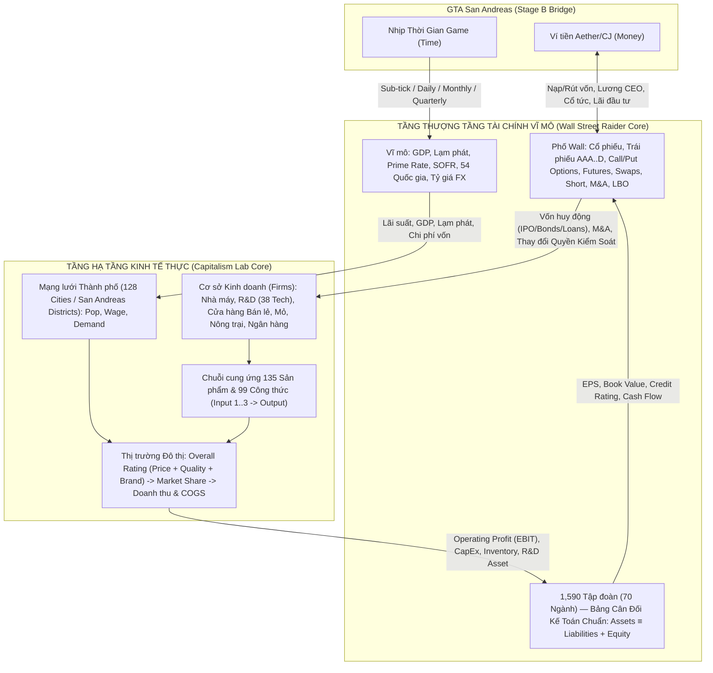

# Phân Tích Toán Học & Kiến Trúc Hệ Thống Capitalism Lab (`CapMain.exe` v11.0.98) & Chiến Lược Hợp Nhất với Wall Street Raider (`EagleCapitalEngine`)

Tài liệu này tổng hợp toàn bộ kết quả dịch ngược mã máy x86 (`CapMain.exe` v11.0.98, `ImageBase = 0x00400000`, `437` module nguồn gốc `E:\CLsrc\*.cpp`) kết hợp với `56` bảng cơ sở dữ liệu `.DBF` trong `gameset/1STD.SET` (đã trích xuất sang [`data/eagle_wsr_caplab_db.json`](../../data/eagle_wsr_caplab_db.json)), nhằm xác lập mô hình toán học chính xác và kiến trúc hợp nhất với **Wall Street Raider (`WSR.EXE`)**.

---

## 1. Bản Đồ Kiến Trúc Thực Thi & Vòng Lặp Thời Gian (`Info::next_day`)

### 1.1. Bản đồ phân hệ C++ trong `CapMain.exe`
Qua quét toàn bộ bảng chuỗi assertion debug (`E:\CLsrc\*.cpp`), `CapMain.exe` được cấu thành từ `437` file nguồn C++ chia làm 6 cụm lõi:

| Cụm hệ thống | Các module nguồn gốc (`E:\CLsrc\*.cpp`) | Dải địa chỉ ảo (`VA`) | Vai trò |
| :--- | :--- | :--- | :--- |
| **Điều phối & Vĩ mô** | `GameInfo.cpp`, `eco.cpp`, `date.cpp` | `0x004E22A6..0x004E468E`, `0x00465484..0x0046905C` | Vòng lặp thời gian (`Info::next_day`), GDP, lạm phát, lãi suất Ngân hàng Trung ương, phát hành trái phiếu chính phủ |
| **Đô thị & Cầu Thị trường** | `Town.cpp`, `Town2.cpp`, `Town3.cpp`, `towitem.cpp`, `Town_Zone.cpp`, `Buyer_Demand.cpp` | `0x00669CF0..0x0067880C`, `0x0044DEC9..0x0044E4F8` | Dân số, mức lương (`WAGE_RATE`), thất nghiệp, co giãn cầu, chấm điểm `Overall Rating` và chia thị phần từng mặt hàng ở từng thành phố |
| **Hàng hóa, R&D & Phần mềm** | `item.cpp`, `item2.cpp`, `itemres.cpp`, `itemtype.cpp`, `TechRes.cpp`, `Soft.cpp`, `SoftRes.cpp`, `Manufacturing.cpp` | `0x0059E9EA..0x005B30E9`, `0x0065DF86..0x0065FC34`, `0x0063CE20..0x00643CE2`, `0x005F29E3..0x005F2D27` | `135` sản phẩm (`ItemInfo`, `0xCF8 = 3,320` bytes/item), `99` công thức sản xuất, `38` công nghệ R&D, `20` loại phần mềm/OS |
| **Cơ sở Kinh doanh (`Firm`) & Ô Chức năng 3x3 (`Job`)** | `Firm.cpp..firm3.cpp`, `j_mft.cpp`, `j_pur.cpp`, `j_sale.cpp`, `j_rd.cpp`, `j_ad.cpp`, `j_crop.cpp`, `j_livest.cpp`, `j_mine.cpp`, `j_ware.cpp`, `F_Adv.cpp`, `F_Store.cpp`, `F_Mine.cpp`, `F_Farm.cpp`, `F_RD.cpp` | `0x004BC220..0x004C6A90`, `0x005BEB02..0x005D7297`, `0x0046B56F..0x004AC5F8` | Nhà máy, nông trại, mỏ, cửa hàng bán lẻ, trung tâm R&D, truyền thông quảng cáo, lưới `3x3` phòng ban liên kết bên trong từng tòa nhà |
| **Ngân hàng, Bảo hiểm & Trái phiếu (`Finance DLC`)** | `F_BankHQ.cpp`, `F_BankBranch.cpp`, `F_InsuranceHQ.cpp`, `Loan.cpp`, `LoanArray.cpp`, `Deposit.cpp`, `Bond.cpp`, `BondArray.cpp`, `Fund.cpp` | `0x00474CA8..0x004789DF`, `0x00490414..0x0049325E`, `0x005DDE63..0x005DFFBA`, `0x00459ED4..0x0045B2A1`, `0x0044A0B0..0x0044BD59` | Huy động tiền gửi (`Deposits`), cho vay doanh nghiệp (`Loans`), tỷ lệ an toàn vốn (`Capital Ratio`), phí bảo hiểm & danh mục đầu tư quỹ bảo hiểm, trái phiếu doanh nghiệp/chính phủ |
| **Tập đoàn (`Group`), Nhân vật (`Person`) & Cổ phiếu (`Stock`)** | `Group.cpp`, `Group2.cpp`, `Group_fi.cpp`, `Person.cpp`, `stock.cpp`, `Stock2.cpp`, `stock_dividend.cpp`, `Stock_M.cpp` | `0x0051A894..0x0052BF6B`, `0x00612E0C..0x00619922`, `0x00645FB2..0x0064EE33` | Bảng cân đối kế toán, báo cáo kết quả kinh doanh, thương hiệu (`Corporate/Range/Unique Brand`), công ty con (`Subsidiary`), lương CEO, cổ tức và định giá cổ phiếu theo `EPS`/`Book Value` |

### 1.2. Vòng lặp thời gian 4 tầng (`Info::next_day` @ `VA 0x004E3EA0`)
Mỗi nhịp mô phỏng cơ sở của Capitalism Lab là **1 Ngày (`1 Day`)** tại hàm `Info::next_day` (`0x004E3EA0..0x004E4450`):
1. **Nhịp Ngày (`Daily Tick` — `0x004E3EA9..0x004E3FA0`):**
   - Tăng `game_date` (`+0x18`), `game_day` (`+0x1C`), cập nhật `day_of_week = game_date % 7` (`+0x2C`).
   - Gọi tuần tự: `GroupArray::next_day` (`0x52B440`) $\rightarrow$ `GlobalGrpArray` (`0x5094D0`) $\rightarrow$ `PersonArray::next_day` (`0x6B53C0`) $\rightarrow$ `TownArray::next_day` (`0x679940`, chạy sản xuất/bán lẻ/cầu thị trường tại mọi thành phố) $\rightarrow$ `PartyArray` (`0x612C50`) $\rightarrow$ `TalentArray` (`0x65A2E0`) $\rightarrow$ `Economy::next_day` (`0x4670B0`) $\rightarrow$ `ItemRes::next_day` (`0x5AD800`) $\rightarrow$ `SoftRes::next_day` (`0x643CB0`) $\rightarrow$ `RawRes` (`0x62A850`) $\rightarrow$ `SiteArray` (`0x63CBC0`) $\rightarrow$ `BondArray::next_day` (`0x44BAC0`) $\rightarrow$ `LoanArray::next_day` (`0x5DFE00`) $\rightarrow$ `DepositArray::next_day` (`0x45ACE0`).
2. **Nhịp Tháng (`Monthly Tick` — `0x004E3FF8..0x004E41D1`, khi `date.month(game_date) != game_month`):**
   - Reset `game_day = 1`, dịch chỉ số mảng cuốn chiếu 36 tháng (`+0x84`, `mod 36`) và 120 tháng (`+0x88`, `mod 120`).
   - Kết toán chi phí cố định hàng tháng (`Overhead`, lương nhân viên, bảo dưỡng nhà máy, chi phí R&D, chi phí quảng cáo, lãi vay ngân hàng/tiền gửi) qua `Economy::next_month` (`0x467210`), `ItemRes::next_month` (`0x5ADB00`), `GroupArray::next_month` (`0x52B580`), `FirmArray::next_month` (`0x4C6A10`), `JobArray::next_month` (`0x5D8710`), `ItemArray::next_month` (`0x5A3EA0`), `SoftArray::next_month` (`0x641190`), `PersonArray::next_month` (`0x6B5510`), `TownArray::next_month` (`0x679BC0`), `BondArray::next_month` (`0x44BB20`), `LoanArray::next_month` (`0x5DFE50`), `DepositArray::next_month` (`0x45AD40`).
3. **Nhịp Quý (`Quarterly Tick` — `0x004E405C..0x004E40A1`, khi `game_month % 3 == 1`):**
   - Dịch chỉ số mảng lịch sử 120 quý (`+0x8C`, `mod 120`) và ghi lịch sử lãi suất, lạm phát, tốc độ tăng trưởng GDP, chỉ số kinh tế tại `Economy::next_month` (`0x00467511..0x0046757A`).
4. **Nhịp Năm (`Yearly Tick` — `0x004E41E0..0x004E43AA`, khi `date.year(game_date) != game_year`):**
   - Reset `game_month = 1`, tăng `game_year` (`+0x28`), dịch chỉ số mảng lịch sử 30 năm (`+0x90`, `mod 30`) và 10 năm (`+0x94`, `mod 10`).
   - Chạy `Economy::next_year` (`0x467650`), `GroupArray::next_year` (`0x52B600` — quyết toán thuế, lương CEO `CEO Salary`, chia cổ tức `Dividends`), `FirmArray::next_year` (`0x4C6A70`), `TownArray::next_year` (`0x679E50`), `PersonArray::next_year` (`0x6B55A0`), `BondArray::next_year` (`0x44BB80`).

---

## 2. Toán Học Cạnh Tranh Thị Trường, Điểm Đánh Giá (`Overall Rating`) & Cầu Đô Thị (`towitem.cpp` & `item2.cpp`)

Đây là trái tim kinh tế vi mô của Capitalism Lab: cách người tiêu dùng tại mỗi thành phố chấm điểm sản phẩm và phân bổ doanh số bán lẻ.

### 2.1. Điều chỉnh Trọng số Tiêu dùng theo Mức sống Thành phố (`TownItem::next_day` @ `VA 0x00669DB8..0x00669E83`)
Trong bảng `PRODUCT_TYPES.DBF`, mỗi sản phẩm $p$ có bộ 3 trọng số gốc $(\text{PRICE\_CN}_p, \text{QUALITY\_CN}_p, \text{BRAND\_CN}_p)$ có tổng bằng $100$ (ví dụ `CAR`: $35, 35, 30$; `BREAD`: $50, 38, 12$; `SMARTPHONE`: $25, 45, 30$).
Tuy nhiên, `CapMain.exe` **không dùng cố định** 3 con số này ở mọi nơi, mà dịch chuyển chúng theo độ giàu/mức lương của từng thành phố $c$ (`Town+0x50` $\Delta W_{\text{price},c}$ và `Town+0x4C` $\Delta W_{\text{qual},c}$):

$$W_{\text{price}}(p,c) = \text{clamp}\!\big(\text{PRICE\_CN}_p + \Delta W_{\text{price},c},\; 20,\; 90\big)$$

$$W_{\text{qual}}(p,c) = \min\!\Big(100 - W_{\text{price}}(p,c),\; \max\!\big(10,\; \text{QUALITY\_CN}_p + \Delta W_{\text{qual},c}\big)\Big)$$

$$W_{\text{brand}}(p,c) = 100 - W_{\text{price}}(p,c) - W_{\text{qual}}(p,c)$$

- Ở thành phố thu nhập cao ($\Delta W_{\text{price},c} < 0, \Delta W_{\text{qual},c} > 0$), khách hàng bớt nhạy cảm về giá và đòi hỏi Chất lượng (`Quality`) + Thương hiệu (`Brand`) cao hơn.
- Ở thành phố thu nhập thấp ($\Delta W_{\text{price},c} > 0$), trọng số Giá ($W_{\text{price}}$) tăng lên (tối đa $90\%$).

### 2.2. Công thức Điểm Đánh Giá Tổng Hợp (`Overall Rating`) Chính Xác Từ Mã Máy (`VA 0x0066A410..0x0066A550` & `VA 0x005A0690..0x005A07F6`)
Hàm `TownItem::calc_overall_rating(quality, brand, price)` (`0x0066A410`) và `Item::overall_rating()` (`0x005A0690`) chia làm 2 trường hợp:

1. **Hàng tiêu dùng & Công nghệ có Thương hiệu (`is_branded != 0`):**
   Với hằng số chuẩn hóa `60.0` (`qword [0x84d8d8]`), hệ số nhân giá `2.0` (`qword [0x84c850]`), sàn phạt giá `-300.0` (`qword [0x86fc40]`), và giá chuẩn địa phương $P_{\text{std}}(p,c)$ (`TownItem+0x0C`):

   $$\text{PriceScore}_{p,c}(P) = \max\!\left(-300.0,\; 2.0 \cdot W_{\text{price}}(p,c) \cdot \frac{P_{\text{std}}(p,c) - P}{P_{\text{std}}(p,c)}\right)$$

   $$\text{OverallRating}_{p,c}(Q, B, P) = \max\!\left(-100,\; \left\lfloor \frac{W_{\text{qual}}(p,c) \cdot Q}{60.0} + \frac{W_{\text{brand}}(p,c) \cdot B}{60.0} + \text{PriceScore}_{p,c}(P) \right\rfloor\right)$$

   *Ý nghĩa toán học:*
   - Khi sản phẩm đạt $Q = 60$, $B = 60$ và bán đúng giá chuẩn $P = P_{\text{std}}(p,c)$, thì $\text{PriceScore} = 0$ và:
     $$\text{OverallRating} = W_{\text{qual}}(p,c) + W_{\text{brand}}(p,c) = 100 - W_{\text{price}}(p,c)$$
   - Nếu giảm giá $50\%$ so với giá chuẩn ($P = 0.5 \, P_{\text{std}}$), điểm thưởng giá cộng thêm đúng bằng $+W_{\text{price}}(p,c)$, đưa $\text{OverallRating}$ chuẩn hóa về đúng $100$!
   - Ngược lại, nếu tăng giá gấp đôi ($P = 2.0 \, P_{\text{std}}$), điểm phạt giá là $-2.0 \cdot W_{\text{price}}(p,c)$ (bị chặn dưới ở $-300$).

2. **Nguyên vật liệu thô & Bán thành phẩm không thương hiệu (`BRAND_CN == 0`, `VA 0x005A07C0..0x005A07EA`):**

   $$\text{OverallRating}_{\text{raw/semi}}(Q, P) = \left\lfloor 100.0 \cdot \frac{P_{\text{std}}(p,c) - P}{P_{\text{std}}(p,c)} + \frac{Q}{2} \right\rfloor$$

### 2.3. Công thức Cầu Hàng Ngày tại Thành phố (`TownItem::calc_demand` @ `VA 0x0066A079..0x0066A407`)
Mỗi ngày, tổng cầu thị trường $D_{\text{daily}}(p,c)$ (tính bằng đơn vị sản phẩm/ngày) của mặt hàng $p$ tại thành phố $c$ được tính qua 3 bước:

1. **Hệ số co giãn theo mặt bằng giá ($\phi_P$):**
   So sánh giá bán trung bình thực tế trên thị trường $P_{\text{avg}}(p,c)$ (`TownItem+0x28`) với giá chuẩn $P_{\text{std}}(p,c)$ theo chỉ số thiết yếu $\text{NECESSITY}_p \in [1, 10]$ (`ItemInfo - 0xCCA`):
   $$\phi_P = \begin{cases} 0.8 + \dfrac{(11 - \text{NECESSITY}_p)\,\big(P_{\text{std}}(p,c) - P_{\text{avg}}(p,c)\big)}{11.0 \cdot P_{\text{std}}(p,c)} & \text{nếu } P_{\text{avg}}(p,c) < P_{\text{std}}(p,c) \\[8pt] 0.8 & \text{nếu } P_{\text{avg}}(p,c) \ge P_{\text{std}}(p,c) \end{cases}$$
   *(Hàng xa xỉ có $\text{NECESSITY}_p$ thấp $\rightarrow 11 - \text{NECESSITY}_p$ lớn $\rightarrow$ giảm giá kích cầu mạnh hơn nhiều so với hàng thiết yếu).*

2. **Cầu cơ sở theo Dân số (`Population`) và Hệ số `DEMAND` gốc (`PRODUCT_TYPES.DBF`):**
   $$D_{\text{base}}(p,c) = \frac{\text{DEMAND}_p \cdot \text{Pop}_c}{365.0} \cdot \phi_P$$

3. **Điều biến theo Sức mua Đô thị, Tăng trưởng GDP và Thất nghiệp (`0x0066A1DA..0x0066A36E`):**
   - Trọng số thiết yếu:
     $$w_{\text{nec}}(p) = 0.8 \cdot \text{NECESSITY}_p + 2.0 \in [2.8,\; 10.0]$$
   - Chỉ số sức mua đô thị $I_{\text{cons},c}$:
     $$I_{\text{cons},c} = \text{clamp}\!\Big(2.0 \cdot (\text{WageRate}_c - 30.0) + \text{clamp}(\text{GDP\_Growth},\; -15.0,\; +15.0) - \Delta U_c(p),\; 10.0,\; 200.0\Big)$$
     trong đó $\Delta U_c(p) = (U_{\text{city},c} - 3.0) \cdot (10 - \text{NECESSITY}_p) \cdot 0.3$ phản ánh tác động của tỷ lệ thất nghiệp vượt mức tự nhiên $3\%$.
   - Cầu thực tế trong ngày:
     $$D_{\text{daily}}(p,c) = D_{\text{base}}(p,c) \times \frac{100.0 \cdot w_{\text{nec}}(p) + \big(10.0 - w_{\text{nec}}(p)\big) \cdot I_{\text{cons},c}}{1000.0}$$
   *(Với mặt hàng thiết yếu tuyệt đối $\text{NECESSITY}_p = 10 \implies w_{\text{nec}} = 10.0 \implies$ hệ số bằng đúng $\frac{1000}{1000} = 1.0$, miễn nhiễm với suy thoái kinh tế; với hàng xa xỉ $\text{NECESSITY}_p = 2 \implies w_{\text{nec}} = 3.6 \implies 64\%$ cầu phụ thuộc vào sức mua đô thị và chu kỳ GDP).*

### 2.4. Cơ chế Phân bổ Thị phần (`Market Share` — `VA 0x0066AD80..0x0066B540`)
Tại mỗi thành phố $c$, tất cả các quầy bán hàng (`JobSale`) đang bày bán mặt hàng $p$ (kèm nguồn cung nội hạt từ cảng/nhập khẩu nếu có) cạnh tranh giành thị phần từ $D_{\text{daily}}(p,c)$:
- Điểm cạnh tranh dịch chuyển về dương:
  $$S_i = \max\!\big(1,\; \text{OverallRating}_i - R_{\min}(p,c) + S_{\text{base}}\big)$$
- Kết hợp với hệ số hiện diện lưu lượng cửa hàng (`Traffic Index` của vị trí đất BĐS nơi đặt `Firm` bán lẻ và năng lực phục vụ `Service Capacity` của quầy `JobSale`), lượng cầu phân bổ cho quầy $i$ là:
  $$Q_{\text{alloc},i} = D_{\text{daily}}(p,c) \cdot \frac{\tau_i \cdot S_i^{\gamma}}{\sum_{j} \tau_j \cdot S_j^{\gamma}}$$
- Lượng bán thực tế bị chặn bởi tồn kho và công suất quầy bán:
  $$Q_{\text{sold},i} = \min\!\big(Q_{\text{alloc},i},\; \text{Inventory}_i,\; \text{MaxSalesThroughput}_i(\text{UnitLevel})\big)$$
- Nếu tổng lượng hàng cung ứng của mọi cửa hàng trong thành phố thấp hơn tổng cầu ($\sum_i Q_{\text{sold},i} < D_{\text{daily}}(p,c)$), phần cầu thiếu hụt được ghi nhận vào `Supply Shortage`, đẩy giá chấp nhận chuẩn $P_{\text{std}}(p,c)$ nhích lên và mở cơ hội tăng giá bán lẻ.

---

## 3. Toán Học Sản Xuất (`JobManufacturing`), Chất Lượng Đầu Ra, R&D (`JobRD`) & Thương Hiệu (`Brand`)

### 3.1. Công thức Chất lượng Sản phẩm Đầu ra (`JobManufacturing::calc_quality` @ `VA 0x005C2600..0x005C2889`)
Trong `MANUFACTURING.DBF`, mỗi công thức chế tạo có tối đa 3 nguyên liệu đầu vào $k \in \{1,2,3\}$ với trọng số chất lượng $\text{IN\_WEIGHT}_k$ và trọng số công nghệ sản xuất $\text{PROD\_TECH}$ sao cho:
$$\text{PROD\_TECH} + \sum_{k=1}^{3} \text{IN\_WEIGHT}_k = 100$$
*(Ví dụ: Sản xuất `CAR` cần `CAR_BODY` trọng số $30\%$, `ENGINE` $20\%$, `WHEEL_TIRE` $20\%$, và `PROD_TECH` $30\%$).*

Tại địa chỉ `0x005C2680..0x005C2862`, chất lượng sản phẩm xuất xưởng $Q_{\text{out}}$ (`JobManufacturing+0x94`) được tính chính xác bằng số học nguyên:

1. **Đóng góp Chất lượng Nguyên liệu đầu vào (`0x005C2680..0x005C26F5`):**
   $$Q_{\text{inputs}} = \left\lfloor \frac{\sum_{k=1}^{n_{\text{in}}} \text{IN\_WEIGHT}_k \times Q_{\text{in},k}}{100} \right\rfloor$$
   *(trong mã máy dùng phép nhân magic number `0x51EB851F` rồi dịch phải `sar edx, 5` = chia nguyên cho `100`).*

2. **Đóng góp Công nghệ R&D của Tập đoàn (`0x005C2717..0x005C2832`):**
   Gọi $\text{FirmTech}_{g,p}$ (`[ebp + 0x98]`) là điểm công nghệ hiện tại của tập đoàn $g$ đối với sản phẩm $p$, và $\text{TopTech}_p$ (`ItemInfo - 0x76C`, khởi tạo ở $100$ và tăng dần khi các tập đoàn R&D vượt mốc $100$) là đỉnh công nghệ thế giới của mặt hàng $p$:
   $$Q_{\text{tech}} = \min\!\left(\text{PROD\_TECH},\; \left\lfloor \frac{\text{PROD\_TECH} \times \text{FirmTech}_{g,p}}{\text{TopTech}_p} \right\rfloor\right)$$
   *(Lưu ý cơ chế cực hay của CapLab: vì chia cho $\text{TopTech}_p$, nếu đối thủ cạnh tranh R&D đẩy $\text{TopTech}_p$ từ $100$ lên $200$ mà tập đoàn của bạn đứng yên ở $\text{FirmTech} = 100$, thì $Q_{\text{tech}}$ của bạn bị tụt một nửa! Đây chính là áp lực chạy đua R&D tự nhiên).*

3. **Cộng thưởng Kỹ năng Nhân công Thành phố & Cấp độ Đào tạo Đơn vị (`0x005C27F9..0x005C2862`):**
   $$Q_{\text{out}} = Q_{\text{inputs}} + Q_{\text{tech}} + \Delta Q_{\text{city}}(c, \text{class}_p) + \left\lfloor \frac{\Delta Q_{\text{training}}(\text{UnitLevel})}{2} \right\rfloor$$

### 3.2. Công thức Sản lượng, Tắc nghẽn Chuỗi cung ứng & Giá vốn Hàng bán (`COGS` & `Freight` @ `VA 0x005C0E04..0x005C1698`)
Tại mỗi nhịp sản xuất trong `JobManufacturing`:
1. **Kiểm tra Nút cổ chai Nguyên liệu (`Bottleneck Input Check` — `0x005C0E56..0x005C0E77`):**
   Với mỗi nguyên liệu $k \in \{1..n_{\text{in}}\}$ yêu cầu định mức $\text{IN\_QTY}_k$ (`[edi]`):
   $$\text{Batches}_{\max} = \min_{k=1..n_{\text{in}}} \left\lfloor \frac{\text{InputStock}_k}{\text{IN\_QTY}_k} \right\rfloor$$
2. **Năng suất Chế tạo Thực tế (`0x005C10EC..0x005C11B5`):**
   Phụ thuộc vào cấp độ kinh nghiệm của phân xưởng $\text{UnitExp} \in [1..9]$ (`+0x88`), tốc độ cơ sở của công thức $\text{RecipeRate}$ (`MANUFACTURING.DBF`), và quy mô tòa nhà nhà máy (`FBUILDSTD.DBF` — `Small / Medium / Large Factory`):
   $$Q_{\text{prod}} = \min\!\Big(\text{Batches}_{\max} \times \text{OUTPUT\_QTY},\; \text{Capacity}_{\text{daily}}(\text{BuildingSize}, \text{RecipeRate}, \text{UnitExp})\Big)$$
3. **Kế toán Giá vốn Bình quân Gia quyền (`Weighted Average Cost` — `0x005C157B..0x005C1698`):**
   Khi tiêu thụ $\Delta M_k = \text{Batches} \times \text{IN\_QTY}_k$ đơn vị nguyên liệu $k$, phân xưởng cộng dồn:
   - Tổng chi phí nguyên vật liệu (`Raw Material Cost`, `[ebx + 0x70]`):
     $$C_{\text{mat}} = \sum_{k=1}^{n_{\text{in}}} \Delta M_k \cdot c_{\text{unit},k}$$
   - Tổng chi phí vận tải nội bộ (`Freight Cost`, `[ebx + 0x78]`):
     $$C_{\text{freight}} = \sum_{k=1}^{n_{\text{in}}} \Delta M_k \cdot f_{\text{unit},k}$$
   - Đơn giá vốn sản xuất của lô thành phẩm (`Unit Cost` chia cho `OUTPUT_QTY` tại `0x005C1655..0x005C168E`):
     $$c_{\text{out}} = \frac{C_{\text{mat}}}{\text{Batches} \cdot \text{OUTPUT\_QTY}}, \qquad f_{\text{out}} = \frac{C_{\text{freight}}}{\text{Batches} \cdot \text{OUTPUT\_QTY}}$$
   - Khi lô hàng nhập vào kho thành phẩm của phân xưởng, chất lượng tồn kho và đơn giá vốn tồn kho được cập nhật theo **bình quân gia quyền** giữa tồn kho cũ $I_{\text{old}}$ và lô mới $Q_{\text{prod}}$:
     $$Q_{\text{inv,new}} = \frac{I_{\text{old}} \cdot Q_{\text{inv,old}} + Q_{\text{prod}} \cdot Q_{\text{out}}}{I_{\text{old}} + Q_{\text{prod}}}, \qquad c_{\text{inv,new}} = \frac{I_{\text{old}} \cdot c_{\text{inv,old}} + Q_{\text{prod}} \cdot c_{\text{out}}}{I_{\text{old}} + Q_{\text{prod}}}$$

### 3.3. Toán học Nghiên cứu & Phát triển (`JobRD` @ `VA 0x005CDBCE..0x005CDF4B` & `.data 0x008D0800..0x008D0850`)
Trích xuất trực tiếp từ vùng dữ liệu `.data` (`0x008D0800..0x008D0850`) và hàm `JobRD::calc_rd_progress` (`0x005CDBCE`):

1. **Bảng Thời hạn Dự án R&D (`0x008D0838`) & Điểm Công nghệ Cơ sở (`0x008D0800`):**
   | Chỉ số gói thời hạn (`k`) | Thời hạn R&D (`Tháng`) | Số ngày (`× 30`) | Điểm Công nghệ Cơ sở thu được (`Base Tech Gain`) |
   | :---: | :---: | :---: | :---: |
   | `0` | `6` tháng | `180` ngày | `+1` |
   | `1` | `12` tháng (1 năm) | `360` ngày | `+3` |
   | `2` | `24` tháng (2 năm) | `720` ngày | `+7` |
   | `3` | `36` tháng (3 năm) | `1,080` ngày | `+11` |
   | `4` | `60` tháng (5 năm) | `1,800` ngày | `+20` |
   | `5` | `120` tháng (10 năm) | `3,600` ngày | `+50` |

2. **Bảng Hệ số Cộng hưởng Nhóm R&D (`Team Synergy Multiplier` @ `0x008D0818`):**
   Khi ghép $N \in \{1..9\}$ phòng `R&D Unit` cùng nghiên cứu 1 đề tài trong lưới `3x3` của tòa nhà R&D Center, hệ số nhân tổng đầu ra không tăng tuyến tính $100\% \times N$ mà tuân theo mảng hằng số chính xác tại `0x008D0818`:
   $$\text{SynergyMultiplier}(N) = \big[100,\; 170,\; 240,\; 295,\; 350,\; 390,\; 430,\; 455,\; 480\big]_N \; (\%)$$
   - `1` phòng: $100\%$
   - `2` phòng: $170\%$ ($85\%$/phòng)
   - `3` phòng: $240\%$ ($80\%$/phòng)
   - `6` phòng: $390\%$ ($65\%$/phòng)
   - `9` phòng (full 3x3): $480\%$ ($53.3\%$/phòng)

3. **Công thức Điểm Công nghệ Đạt được (`Tech Gain` @ `0x005CDC62..0x005CDCE1`):**
   $$\Delta \text{Tech} = \text{BaseTechGain}_k \times \frac{\text{SynergyMultiplier}(N)}{100} \times \frac{\overline{\text{UnitEfficiency}}}{100} \times \phi_{\text{talent}} \times \phi_{\text{CTO}}$$
   *(trong đó $\phi_{\text{talent}}$ là hệ số chuyên môn của nhà khoa học ngành đó trong hệ thống `Talent` và $\phi_{\text{CTO}}$ là hệ số thưởng của Giám đốc Công nghệ `CTO` nếu có).*

### 3.4. Toán học Thương hiệu (`Brand Strategy`) & Quảng cáo (`F_Adv.cpp` @ `VA 0x0046B56F` & `item2.cpp` @ `VA 0x005A042E..0x005A0587`)
Tại `Item::brand_rating` (`0x005A042E`), tập đoàn (`Group + 0xA0`) chọn 1 trong 3 chiến lược thương hiệu:
1. **`Corporate Brand` (`mode = 1`):** Mọi sản phẩm của tập đoàn tại thành phố $c$ dùng chung 1 điểm thương hiệu tập đoàn (`TownGroup`). Chi phí quảng cáo cực kỳ tiết kiệm nhưng nếu bán 1 mặt hàng chất lượng thấp ($Q < 40$), điểm `Brand Loyalty` của **toàn bộ tập đoàn** tại thành phố đó bị kéo tụt!
2. **`Range Brand` (`mode = 2`):** Thương hiệu tính riêng theo từng nhóm ngành hàng (`Product Class`, `ItemInfo - 0xC98`, gồm `25` nhóm ngành trong `PRODUCT_CLASSES.DBF` như Thực phẩm, May mặc, Điện tử, Ô tô...). Cân bằng giữa chi phí marketing và cô lập rủi ro chất lượng giữa các ngành.
3. **`Unique Product Brand` (`mode = 3`):** Mỗi sản phẩm $p$ ở mỗi thành phố $c$ có điểm `Advertising Brand` và `Brand Loyalty` độc lập hoàn toàn (`Item + 0x70`, `Item + 0x72`). Tốn ngân sách quảng cáo gấp nhiều lần nhưng miễn nhiễm chéo hoàn toàn.

Tổng điểm thương hiệu ở mọi chế độ đều là:
$$B(p,c) = \text{clamp}\!\big(B_{\text{adv}}(p,c) + B_{\text{loyalty}}(p,c),\; -100,\; 100\big)$$
- $B_{\text{adv}}(p,c) \in [0, 100]$: Tăng hàng ngày theo chi tiêu quảng cáo chia cho `Rating Divider` của đài TV/Radio/Báo/Internet (`F_Adv.cpp` `0x0046B7D4..0x0046BC60`), và suy giảm tự nhiên hàng tháng nếu ngừng chi quảng cáo.
- $B_{\text{loyalty}}(p,c) \in [-100, 100]$: Hội tụ chậm về mức hài lòng của người tiêu dùng dựa trên chênh lệch giữa chất lượng sản phẩm thực tế $Q$ và kỳ vọng của khách hàng tại thành phố đó.

---

## 4. Toán Học Vĩ Mô, Ngân Hàng/Bảo Hiểm & Định Giá Cổ Phiếu Trong Capitalism Lab

### 4.1. Kinh tế Vĩ mô & Ngân hàng Trung ương (`eco.cpp` @ `VA 0x004670B0..0x004676D0`)
Trong `Economy::next_month` (`0x00467210`):
- Cập nhật chu kỳ GDP (`0x4683C0`), tỷ lệ lạm phát (`[edi + 0x60]`, `0x467FB0`) và lãi suất điều hành (`[edi + 0x28]`, `0x467960`).
- Ngân hàng Trung ương (`Central Bank Policy` tại `[edi + 0x34]`, gồm 5 thiên hướng chính sách từ chống lạm phát diều hâu đến kích thích tăng trưởng bồ câu) tự động điều chỉnh lãi suất mục tiêu `[edi + 0x38]` mỗi tháng (`+1` hoặc `-1` bậc) khi lạm phát `[edi + 0x60]` vượt ngưỡng mục tiêu, đồng thời đặt tỷ lệ dự trữ bắt buộc `[edi + 0x40] = 10 * [edi + 0x38]`.
- Vào tháng 2 hàng năm (`game_month == 2`), nếu bật hệ thống Trái phiếu (`Bond`), chính phủ/đô thị phát hành trái phiếu kỳ hạn `3, 5, 10` năm (`[esp + 0x30..0x38]` theo `year % 3` tại `0x00467250..0x00467386`).

### 4.2. Ngân hàng Thương mại & Bảo hiểm (`F_BankHQ.cpp` & `F_InsuranceHQ.cpp`)
- **Ngân hàng (`Bank`):** Nhận tiền gửi (`DepositArray`) từ dân cư và doanh nghiệp với lãi suất huy động $r_{\text{dep}}$,放 vay (`LoanArray`) cho các tập đoàn theo xếp hạng tín nhiệm với lãi suất cho vay $r_{\text{loan}} > r_{\text{dep}}$. Phải duy trì tỷ lệ an toàn vốn (`Capital Ratio`) và thanh khoản dự trữ; nếu nợ xấu (`Defaulted Loans`) ăn mòn vốn chủ sở hữu xuống dưới ngưỡng tối thiểu, ngân hàng rơi vào khủng hoảng thanh khoản.
- **Bảo hiểm (`Insurance`):** Thu phí bảo hiểm định kỳ (`Premiums`), trích lập dự phòng bồi thường (`Claims Reserve`), và dùng dòng tiền nhàn rỗi (`Float`) để mua cổ phiếu/trái phiếu tạo thu nhập đầu tư (`Investment Income`).

### 4.3. Định giá Cổ phiếu trong Capitalism Lab (`Stock::calc_financial_ratios` & `Stock::next_day` @ `VA 0x00647800..0x006480A5`)
Phân tích hàm `0x006478A0..0x00647B51` cho thấy cách Capitalism Lab định giá cổ phiếu của tập đoàn $g$:
1. **Giá trị Sổ sách trên mỗi Cổ phần (`Book Value Per Share` — `0x006478EC`):**
   $$\text{BVPS}_g = \frac{\text{NetWorth}_g \; (\text{[edi + 0xCC8]})}{\text{Shares}_g \; (\text{[ebx + 0x08]})}$$
2. **Thu nhập Hoạt động Hợp nhất trên mỗi Cổ phần (`Consolidated Operating EPS` — `0x0064795F..0x00647AD6`):**
   Cộng lợi nhuận hoạt động cốt lõi của công ty mẹ (`Group::calc_eps(1)`) với phần lợi nhuận xuyên thấu (`Look-through Earnings`) từ mọi cổ phần nắm giữ tại các tập đoàn khác $h \in \{1..N_{\text{groups}}\}$:
   $$\text{EPS}_{\text{consol},g} = \text{EPS}_{\text{op},g} + \frac{1}{\text{Shares}_g} \sum_{h=1}^{N_{\text{groups}}} \text{SharesOwned}_{g \to h} \times \text{EPS}_{\text{trailing},h}$$
3. **Hệ số `P/E` Hợp nhất (`Consolidated P/E` — `0x00647B17..0x00647B2C`):**
   $$\text{PE}_{\text{consol},g} = \frac{P_{\text{stock},g}}{\text{EPS}_{\text{consol},g}}$$
4. **Cập nhật Giá Cổ phiếu (`0x00647B70..0x006480A5`):**
   Giá cổ phiếu $P_{\text{stock},g}$ (`[esi + 0x18]`) dịch chuyển hàng ngày xoay quanh mức định giá mục tiêu dựa trên bội số $\text{PE}_{\text{benchmark}}$ của thị trường (`~10..15x` điều chỉnh theo lãi suất) cộng với phần đệm tài sản ròng (`Book Value` / tiền mặt ròng tại `0x00647EA7..0x00647EF7`).

---

## 5. Đối Chiếu Bản Chất & Phương Pháp Hợp Nhất (`Merge Approach`) WSR + Capitalism Lab

### 5.1. Tại sao 2 tựa game này là 2 nửa hoàn hảo của cùng một Cỗ máy Kinh tế?
Khi đặt mã máy của **Wall Street Raider (`WSR.EXE`)** cạnh **Capitalism Lab (`CapMain.exe`)**, ta thấy sự bù trừ tuyệt đối:

| Chiều kích hệ thống | Wall Street Raider (`WSR.EXE`) | Capitalism Lab (`CapMain.exe`) | Giải pháp Hợp nhất trong `EagleCapitalEngine` |
| :--- | :--- | :--- | :--- |
| **Quy mô Vũ trụ Doanh nghiệp** | Rất lớn: `1,590` tập đoàn, `70` ngành công nghiệp, `54` quốc gia, `263` sở hữu chéo ban đầu | Nhỏ: `10..64` tập đoàn trong 1 ván, nhưng đi sâu vào từng nhà máy/cửa hàng | Giữ nguyên vũ trụ **`1,590` tập đoàn / `70` ngành** của WSR làm khung xương sống toàn cầu |
| **Tài chính Thượng tầng & Phố Wall** | **Cực kỳ sâu sắc:** Trái phiếu `AAA..D`, Options (Call/Put), Futures, Interest Rate Swaps, M&A, Hostile Takeover, LBO, Spin-off, Greenmail, Antitrust, Chống lũng đoạn, Thuế phức hợp | **Đơn giản:** Chỉ có mua/bán cổ phiếu giao ngay, phát hành cổ phiếu, vay ngân hàng và trái phiếu cơ bản (không có phái sinh, không có Swap/LBO/Short-selling) | Dùng **100% mô hình Thượng tầng Tài chính của WSR** làm động cơ định giá vốn, tín dụng, phái sinh, M&A và thuế cho mọi tập đoàn |
| **Kinh tế Thực & Chuỗi Cung Ứng** | **Trừu tượng hóa vĩ mô:** Mỗi tập đoàn chỉ có 1 con số `Business Assets`, sinh lời theo `Demand Growth` ngành và thị phần vĩ mô `Market Share` | **Cực kỳ chi tiết:** `135` sản phẩm, `99` công thức `Input 1..3 -> Output`, `128` thành phố, R&D `38` công nghệ, Brand `3` chế độ, Cửa hàng bán lẻ, Nhà máy, Mỏ, Nông trại | Dùng **100% mô hình Hạ tầng Kinh tế Thực của Capitalism Lab** để vận hành hoạt động sản xuất, R&D, chuỗi cung ứng và bán lẻ |
| **Dòng tiền Cá nhân của Người chơi** | Người chơi có bảng cân đối cá nhân (`Personal Cash`, `Margin Loan`, `Stock/Options Portfolio`) và nhận `CEO Salary` + `Dividends` từ các công ty mình kiểm soát | Người chơi nhận `CEO Salary` + `Dividends` hàng năm và dùng `Personal Cash` mua cổ phiếu hoặc lập công ty mới | Kết nối **Trục Tiền Tệ (`Money`)** của GTA SA (`CJ/Aether Wallet`) $\leftrightarrow$ `Personal Cash` của người chơi $\leftrightarrow$ `Corporate Cash` của các tập đoàn do người chơi kiểm soát |

---

## 6. Kiến Trúc Toán Học Hợp Nhất (`Unified Mathematical Architecture`)

Để vừa giữ được `1,590` tập đoàn sống động mỗi nhịp `< 2 ms`, vừa cho phép người chơi và các đối thủ lớn xây dựng nhà máy, chuỗi cung ứng `Input 1..3 -> Output`, R&D và cửa hàng bán lẻ chuẩn Capitalism Lab, ta áp dụng kiến trúc **Hai Tầng Đồng Bộ (`Dual-Layer Hybrid Simulation`)**:

### 6.1. Cơ chế Hai Chế độ Vận hành Doanh nghiệp (`Hybrid LOD: Macro-Statistical vs. Micro-Simulated`)
Mỗi tập đoàn $g \in \{1..1590\}$ đều có chung một cấu trúc **Bảng Cân Đối Kế Toán (`Balance Sheet`)** và **Báo Cáo Kết Quả Kinh Doanh (`Income Statement`)** chuẩn WSR, nhưng phần tạo ra lợi nhuận hoạt động (`Operating EBIT`) được tính theo 1 trong 2 chế độ chuyển đổi mượt mà:

1. **Chế độ Vĩ mô Thống kê (`LOD 0 — Macro-Statistical`, mặc định cho ~`1,000+` tập đoàn AI nền của WSR):**
   - Dùng công thức ROA ngành của WSR kết hợp chỉ số `Tech` và `Brand` đại diện ở cấp ngành (`70` ngành WSR ánh xạ sang `25` `PRODUCT_CLASSES` + `135` `PRODUCT_TYPES` của CapLab):
     $$\text{EBIT}_{g}^{\text{(LOD 0)}} = A_{\text{biz},g} \cdot R_{\text{ind}}(I_g, \text{GDP}, r_{\text{prime}}, \text{MarketShare}_g) - D_{\text{dep},g}$$
   - Thời gian tính toán cho toàn bộ `1,058` tập đoàn ở `LOD 0` bằng vector hóa/mảng phẳng chỉ mất **~`0.3 ms`**.

2. **Chế độ Vi mô Chuỗi cung ứng (`LOD 1 — Micro-Simulated`, dành cho Tập đoàn của Người chơi, các Công ty con trực thuộc, và Top Tập đoàn Đối thủ cạnh tranh trực tiếp tại các thành phố đang hoạt động):**
   - Tập đoàn sở hữu danh sách các `Firm` thực tế (Nhà máy `JobManufacturing`, Quầy bán lẻ `JobSale`, Trung tâm `JobRD`, Truyền thông `F_Adv`, Mỏ/Nông trại) đặt tại các thành phố $c$.
   - Mỗi ngày/tháng, động cơ chạy đúng chuỗi phương trình của Capitalism Lab đã giải mã ở Mục 2 & Mục 3:
     - Tính $W_{\text{price}}(p,c), W_{\text{qual}}(p,c), W_{\text{brand}}(p,c)$ và điểm $\text{OverallRating}_{p,c}(Q, B, P)$ (`VA 0x0066A410`).
     - Tính cầu đô thị $D_{\text{daily}}(p,c)$ (`VA 0x0066A079`) và phân bổ lượng bán $Q_{\text{sold},i}$ cho từng cửa hàng/nhà máy.
     - Tính sản lượng nhà máy, tiêu hao nguyên liệu `Input 1..3`, đơn giá vốn $c_{\text{out}}$, cước vận chuyển $f_{\text{out}}$ (`VA 0x005C0E04`) và chất lượng xuất xưởng $Q_{\text{out}}$ (`VA 0x005C2600`).
     - Cập nhật tiến độ R&D theo bảng cộng hưởng `[100..480]%` (`VA 0x008D0818`).

### 6.2. Bốn Phương Trình Cầu Nối (`Bridge Equations`) Giữa Hạ Tầng CapLab và Thượng Tầng WSR
Để không xảy ra bất kỳ sự lệch pha kế toán nào giữa hai hệ thống, mọi tập đoàn ở `LOD 1` kết nối trực tiếp lên Bảng Cân Đối Kế Toán WSR qua 4 phương trình bảo toàn:

1. **Phương trình Đồng bộ Tài sản Kinh doanh (`Business Assets` & `Inventory` Synchronization):**
   Trong WSR, tập đoàn có khoản mục `Capital Assets / Business Assets` ($A_{\text{biz},g}$). Khi hợp nhất với CapLab, $A_{\text{biz},g}$ được phân rã chính xác thành:
   $$A_{\text{biz},g} \equiv \sum_{f \in \text{Firms}_g} \Big(\text{LandValue}_f + \text{BuildingBookValue}_f + \text{InventoryValue}_f\Big) + A_{\text{macro\_residual},g}$$
   - Khi tập đoàn xây một nhà máy/cửa hàng mới chi phí $C_{\text{build}}$ (`FBUILDSTD.DBF`) trên lô đất trị giá $L_f$:
     $$\Delta \text{Cash}_g = -(C_{\text{build}} + L_f), \qquad \Delta A_{\text{biz},g} = +(C_{\text{build}} + L_f) \implies \Delta \text{TotalAssets}_g = 0$$
   - Khi nhà máy mua nguyên liệu từ tập đoàn khác với giá trị $M$:
     $$\Delta \text{Cash}_g = -M, \qquad \Delta \text{InventoryValue}_g = +M \implies \Delta \text{TotalAssets}_g = 0$$

2. **Phương trình Kết chuyển Lợi nhuận Hoạt động (`Micro P&L` $\to$ `WSR Corporate EBIT`):**
   Lợi nhuận hoạt động trước lãi vay và thuế (`EBIT`) của tập đoàn $g$ trong kỳ là tổng lợi nhuận từ toàn bộ các `Firm` vi mô cộng với phần tài sản vĩ mô còn lại (nếu tập đoàn vừa có mảng vĩ mô vừa có nhà máy vi mô):
   $$\text{EBIT}_g = \sum_{f \in \text{Firms}_g} \Big(\text{Revenue}_f - \text{COGS}_f - \text{Freight}_f - \text{OperatingOverhead}_f - \text{R\&D\_Expense}_f - \text{AdExpense}_f - \text{Depreciation}_f\Big) + \text{EBIT}_{\text{macro\_residual},g}$$
   Từ $\text{EBIT}_g$, tầng WSR tiếp nhận để cộng/trừ:
   - Thu nhập lãi tiền gửi / trái phiếu chính phủ ($+\text{InterestIncome}_g$)
   - Chi phí lãi vay ngân hàng & coupon trái phiếu doanh nghiệp ($-\text{InterestExpense}_g$)
   - Lãi/lỗ định giá theo thị trường (`Mark-to-Market`) của hợp đồng `Interest Rate Swaps`, `Options`, `Futures`, `Stocks`
   - Thuế thu nhập doanh nghiệp (`Corporate Income Tax` & `Tax Loss Carryforward` chuẩn WSR)
   $\implies$ Kết chuyển ra $\text{NetIncome}_g \to \Delta \text{RetainedEarnings}_g$.

3. **Phương trình Định giá Cổ phiếu Hợp nhất (`Unified Stock Valuation`):**
   Kết hợp mô hình định giá tài sản ròng + P/E xuyên thấu của CapLab (`VA 0x006478A0`) với mô hình cung cầu/tâm lý thị trường và phần bù rủi ro tín nhiệm của WSR:
   $$P_{\text{fundamental},g} = \frac{w_{\text{NW}} \cdot \text{NetWorth}_g + w_{\text{E}} \cdot \text{PE}_{\text{ind}}(r_{\text{prime}}, \text{Growth}_g, \text{TechLead}_g, \text{Brand}_g) \cdot \text{Earnings}_{\text{consol},g}}{\text{Shares}_g}$$
   - Khi tập đoàn đột phá R&D (tăng $\text{FirmTech}_{g,p}$ vượt $\text{TopTech}_p$) hoặc chiếm lĩnh thị phần bán lẻ ở các thành phố, cả $\text{Earnings}_{\text{consol},g}$ lẫn hệ số định giá $\text{PE}_{\text{ind}}$ đều tăng, đẩy giá cổ phiếu và giá quyền chọn `Call Options` trên sàn Phố Wall tăng vọt!
   - Ngược lại, nếu chuỗi cung ứng bị đứt gãy (nhà cung cấp nguyên liệu đầu vào hủy hợp đồng hoặc tăng giá, khiến nhà máy bị `Bottleneck` sụt công suất), `EBIT` sụt giảm $\to$ xếp hạng tín nhiệm trái phiếu WSR bị hạ bậc (`AAA` $\to$ `BBB` $\to$ `B`) $\to$ lãi suất vay ngân hàng tăng $\to$ giá cổ phiếu lao dốc, mở ra cơ hội để người chơi (hoặc cá mập AI trên sàn WSR) thực hiện **Bán khống (`Short-selling`)** hoặc **Thâu tóm thù địch (`Hostile Takeover` / `LBO`)** rồi tái cấu trúc lại chuỗi cung ứng!

4. **Phương trình Đồng bộ M&A / Thâu tóm Công ty Con (`WSR Acquisition` $\leftrightarrow$ `CapLab Subsidiary & Supply Chain`):**
   - Trong WSR, khi Tập đoàn $A$ mua trên $50\%$ cổ phần của Tập đoàn $B$, $B$ trở thành `Subsidiary` (`Controlled Corp`).
   - Nhờ hợp nhất với CapLab, ngay khi $A$ kiểm soát $B$ trên sàn chứng khoán WSR, người chơi (CEO của $A$) lập tức có quyền:
     - Chỉ định các nhà máy/mỏ của $B$ ưu tiên bán nguyên liệu độc quyền (`Internal Transfer / Exclusive Supply`) cho nhà máy của $A$ với giá vốn nội bộ (`Cost + Margin` thấp), cắt đứt nguồn cung nguyên liệu của các đối thủ cạnh tranh khác!
     - Chuyển giao bản quyền công nghệ R&D (`Tech Transfer / Licensing`) giữa $A$ và $B$.
     - Điều chỉnh tỷ lệ chia cổ tức (`Dividend Payout`) và lương CEO (`CEO Salary`) của $B$ để rút dòng tiền hợp pháp về công ty mẹ $A$ hoặc về ví cá nhân của người chơi.

### 6.3. Đồng bộ Trục Thời Gian (`Time`) & Trục Tiền Tệ (`Money`)
1. **Đồng bộ Thời gian (`Time Bridge`):**
   - WSR chạy theo nhịp `Sub-tick` trong Quý (`1 Quý = 90 Ngày`).
   - Capitalism Lab chạy theo nhịp `1 Ngày` (`Info::next_day`), `1 Tháng` (`30 Ngày`), `1 Quý` (`90 Ngày`), `1 Năm` (`360/365 Ngày`).
   - **Quy ước hợp nhất hoàn hảo:**
     - **Mỗi nhịp cơ sở (`1 Tick = 1 Ngày Game`)**:
       - Tầng WSR cập nhật biến động giá giao dịch trong ngày của Cổ phiếu, Trái phiếu, Options, Futures, tỷ giá FX và kiểm tra `Margin Call`.
       - Tầng CapLab chạy sản xuất nhà máy (`JobManufacturing`), phân bổ cầu và bán hàng tại các thành phố (`TownItem`), tích lũy tiến độ R&D (`JobRD`) và độ phủ quảng cáo (`F_Adv`).
     - **Mỗi 30 Ngày (`Monthly Settlement`)**:
       - Tầng CapLab kết toán lương nhân viên, chi phí vận hành tòa nhà (`Overhead`), ngân sách R&D/Marketing tháng, cập nhật lạm phát và lãi suất Ngân hàng Trung ương.
       - Tầng WSR thu/trả lãi vay ngân hàng, coupon trái phiếu định kỳ và phí quản lý.
     - **Mỗi 90 Ngày (`Quarterly Financial Reporting`)**:
       - Hợp nhất báo cáo tài chính Quý (`Quarterly 10-Q`: `Revenue`, `EBIT`, `Net Income`, `EPS`, `Book Value`, `Credit Rating AAA..D`) cho toàn bộ `1,590` tập đoàn, thanh toán cổ tức Quý (`Quarterly Dividends`) và đáo hạn các hợp đồng Options/Futures đến hạn.
     - **Mỗi 360 Ngày (`Annual Closing`)**:
       - Quyết toán thuế thu nhập doanh nghiệp & thuế thu nhập cá nhân, trả lương thưởng CEO (`CEO Salary & Bonus`), cập nhật dân số đô thị và phát hành trái phiếu chính phủ mới.

2. **Đồng bộ Tiền tệ (`Money Bridge`):**
   - Đơn vị lưu trữ nội bộ của `EagleCapitalEngine`: số thực chính xác kép `float64` quy theo **Triệu USD (`$1.0 = $1,000,000`)** ở tầng tập đoàn WSR, và **USD thực (`$1`)** ở tầng đơn giá sản phẩm CapLab (với hệ số chuyển đổi cố định $1\text{ M\$} = 10^6\text{ USD}$).
   - Ví tiền cá nhân của nhân vật chính trong GTA SA (`Wallet Cash`) liên thông 2 chiều với `Tài khoản Môi giới & Đầu tư Cá nhân` (`Personal Brokerage Account`) trong `EagleCapitalEngine`, đảm bảo phương trình kế toán:
     $$\text{Total Assets} \equiv \text{Total Liabilities} + \text{Shareholders' Equity}$$
     luôn thỏa mãn tới từng xu ở mọi giao dịch.
